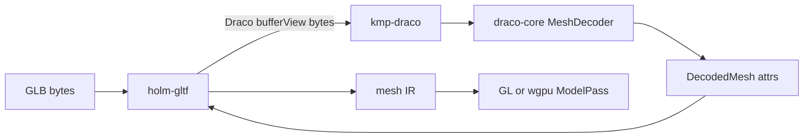

# kmp-draco + holm-gltf 接入（Tokyo / KHR_draco）

依据：审讯 Q1–Q11（2026-11-18）；kmp-draco ADR 0001；Holm ADR 0017。

## 目标

- 独立仓 `~/Studio/kmp/kmp-draco`：Android 上把 Draco **比特流**解成 **分属性数组**
- `:holm-gltf` 硬依赖该库，展开 `KHR_draco_mesh_compression`
- Demo **LittlestTokyo**（或等价 required-Draco glb）不再空白；失败走异常 / onError

## 非目标

- iOS / Ohos / Wasm 端 native（后补）
- point cloud / encode 公开 API
- Provider SPI、Filament、把 Draco 塞进 kmp-wgpu
- 本单不改 ModelPass 着色模型（仍用已展开属性）

## 架构

## 里程碑

### M0 — kmp-draco 仓骨架 + Android decode

仓：`~/Studio/kmp/kmp-draco`

1. Gradle KMP 单模块 `:kmp-draco`；`android` + common 脸；Maven 坐标 `io.github.sofarnobug:kmp-draco`
2. Rust crate（decoder-only `draco-core`）+ JNI/cinterop 导出同步 decode
3. Kotlin：`decode(ByteArray): DecodedMesh`；属性分数组 + 元数据；失败 `DracoDecodeException`
4. 单测 / 冒烟：对 Tokyo 抽出的 `.drc` 或 bufferView 切片能出 POSITION（+ 若有则 NORMAL/UV/indices）

**验收**：Android 单元或 instrumented：已知 Draco 字节 → 非空 positions；坏字节抛异常。

### M1 — holm-gltf 接线

仓：`KuiklyHolm`

1. `:holm-gltf` 依赖 kmp-draco（Maven 或 `includeBuild`，键名实现时定，对齐 wgpu local 习惯）
2. 解析 `KHR_draco_mesh_compression`：取 bufferView 字节 → decode → 按 accessor 填回现有 IR
3. required extension / decode 失败：**上抛**，Presenter 进 onError（禁止空 meshes 静默成功）

**验收**：解析 Tokyo → 有 mesh；故意坏流 → onError 可见。

### M2 — Demo + 文档

1. Demo 资产确认 Tokyo（或同扩展 glb）在 `holm_model` / DualTrack Model 路径可拖可见
2. guide / changelog / `device-check-list` 勾 Draco；CONTEXT/glossary 已有则核对

## 风险

- `draco-core` 与官方 bitstream 边界差异 → Tokyo 实测钉；不足再开 ADR 修订内核
- native 包体 → 实现后量 `.so`；不回退身份除非产品改口选 C++

## 放行后编码

用户确认本计划 → 编码前确认闸选 **1** 或 **执行**；并 Read 对应 coding skill（跨仓则 Holm + 新仓约定）。
