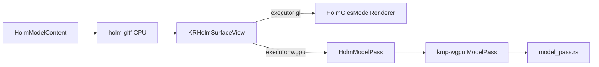

# 真 wgpu Model Pass（仅 Android · kmp-wgpu A 路径）

依据：用户确认「仅 Android + A」；审查 `P1-plan-soft-drift`；ADR 0013/0015/0016。

## 目标

`HolmModelContent` + `executor=renderer-wgpu` 时：

- **销毁/不创建** GLES 模型层出画
- 使用 **kmp-wgpu-native 新 ModelPass**（独立于 FullscreenPass）上传网格、每帧 MVP、unlit/首灯 Lambert
- `onReady.backend` 报真实 wgpu id（如 `wgpu-m0`），**禁止**再报 GLES 冒充

`executor=renderer-gl`：保持现有 `HolmGlesModelRenderer`（本单不拆）。

非 Android：仍 `MODEL_UNSUPPORTED`。

## 架构

**边界**：glTF 解析仍在 `holm-gltf`；kmp-wgpu **只收** 已展开的 `positions/normals/indices` + 每帧 uniform（MVP、color、light），不懂 glb。

## 里程碑

### M0 — kmp-wgpu：ModelPass 原语（Android JNI 先通）

仓：`~/Studio/kmp/kmp-wgpu`

1. **Rust** `kmp-wgpu-native/src/model_pass.rs`
   - 与 Fullscreen 类似持有 Device/Queue/Surface（可共享创建路径或独立 session；**推荐独立 session**，避免与 Fullscreen 片元管线抢 bind group）
   - API 概念：
     - `create(surface, w, h)`
     - `set_meshes([{ pos, nrm, idx }…])` 上传 VBO/IBO（合并或多 draw）
     - `set_frame(mvp[16], color[4], lit, light_dir[3])`
     - `set_playing` / `tick(dt)` / `resize` / `destroy`
     - `backend_id` / `drain_errors`（复用 error_bridge）
   - WGSL：简易 VS（pos+nrm → clip）+ FS（unlit 或 Lambert）
   - Depth：开 depth buffer（与 Fullscreen 清屏路径区分）

2. **JNI**（Android 优先）：`android_jni.rs` 导出上述入口；其它端 stub / 暂不实现亦可（Holm 本波只用 Android）。

3. **Kotlin** `kmp-wgpu-surface`
   - `ModelPass` common + `androidMain` actual（镜像 FullscreenPass 形态）
   - `WgpuSurface.createModelPass(...)`（Android）

4. **版本**：本地 `includeBuild` / Maven SNAPSHOT 由 Holm `kmp.wgpu.local=true` 联调；发版号另议（本单可不发 Maven）。

**验收**：kmp-wgpu sample 或最小 JNI 冒烟：清屏色 + 固定立方体转一帧（可选）。

### M1 — Holm 薄适配 + View 接线

仓：`KuiklyHolm`

1. `holm-renderer-wgpu`（android）：`HolmModelPass` 薄包 `ModelPass`（同 `HolmFullscreenPass` 风格）。
2. `KRHolmSurfaceView` / `HolmAndroidModelPresenter`：
   - Model + **GL** → 现 GLES 层（不变）
   - Model + **wgpu** → 显示 `_runtimeView`，**创建 ModelPass**（不要 FullscreenPass）；异步 parse 后 `setMeshes`；Choreographer 泵 `set_frame`（orbit yaw/pitch）+ `tick`
   - 切 Content/卸岛：对称 destroy ModelPass；切回 Shader 时再走 FullscreenPass
3. `fireReady`：Model+wgpu → `pass.backendId()`；Model+GL → `gles2` / `gles2-model`
4. 关掉「wgpu executor 也挂 GLES 模型层」的捷径。

**验收**：`holm_model` 页切 `renderer-wgpu` 见模、可拖；log/`onReady.backend` 为 `wgpu-m0*`；切回 gl 仍 GLES 画模。

### M2 — 文档 / 审查债

1. ADR 0016 补一句：wgpu Model Present = kmp-wgpu `ModelPass`（非 FullscreenPass）。
2. guide + changelog append（`docs/specs/holm-content-gltf/` 或新 feature 目录）。
3. 关审查：`P1-plan-soft-drift`、`P1-doc-drift`（backend 诚实）；`P1-concurrency` 在 ModelPass 路径同样做 surface-ready 后再 upload。
4. 真机表更新：`device-check-list/holm-content-gltf.md` 步骤 #8 断言 **真 wgpu backend**，非 GLES 层。

## 非目标

- iOS / H5 / Ohos ModelPass 真画
- 蒙皮 / 动画 / PBR 全套 / http
- 把 glTF 解析塞进 kmp-wgpu
- Filament
- Trusted Publishing 发版（可本地联调）

## 风险

| 风险 | 缓释 |
|---|---|
| Surface 上 Fullscreen 与 Model 会话互斥 | View 层互斥创建；切 Content 急拆 |
| Depth/format 与现 Surface config 不兼容 | ModelPass 自配 depth；对照 adapter caps |
| native `.so` 未重编 | 本单 checklist：重编 `libkmp_wgpu_native` 并装进 androidApp |
| 包体 | ModelPass 代码量小；只用 Shader 的宿主仍可不链 Model 路径（Kotlin 可选调用） |

## 建议实现顺序

1. kmp-wgpu Rust ModelPass + Android JNI  
2. Kotlin ModelPass API  
3. Holm 适配 + View 分支  
4. Demo 真机 + 文档 / 关审查项  

确认本计划后回复「按计划执行」或「执行」再开工（须 Read 对应编码 Skill；跨仓改 kmp-wgpu）。
