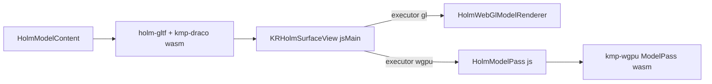

# Plan · H5 Model 真画（ADR 待立）

依据：用户「准备实现 H5 平台」；对照 ADR 0016/0018/0019（H5 现为 **非目标 / BLOCKED**）；Ohos 已闭环 `holm-ohos-glb-r4`。

## 现状（不可跳过）

| 项 | 现状 |
|---|---|
| 产品 | `HolmModelContent` 真画 = Android+iOS+Ohos；**H5 = `MODEL_UNSUPPORTED` + 清屏** |
| View | `KuiklyHolmCore/.../jsMain/.../KRHolmSurfaceView.kt` 挂 Model → 清 shader + `fireError` |
| kmp-wgpu H5 | 仅 **FullscreenPass** wasm；**无** ModelPass jsMain / wasm mesh ABI |
| holm-gltf | Core **jsMain 不依赖** `:holm-gltf`（刻意减重） |
| Draco | kmp-draco 已有 H5 wasm；`holm-gltf` jsMain `DracoBitstream` 仍抛「需 Android」类文案 |
| 资产 | GLB 在 Android assets / iOS Bundle / Ohos rawfile；**H5 无镜像静态树** |
| Demo | `holm_model` commonMain 会跑到 H5，但必红字；footer 仍写 Ohos unsupported（文案债） |

**结论**：未立新 ADR（或修订 0016）前，按现行 `holm_api` **不得**把 H5 静默画成「已通」。

## 建议目标（待拍板）

`HolmModelContent` 在 H5 **双轨真画**，对齐三端语义：

- `renderer-gl` → **WebGL1/2 网格宿主**（backend ≈ `webgl-model` 或 `gles2-model` 口径另定）
- `renderer-wgpu` → **kmp-wgpu ModelPass（canvas / wasm）**；无 WebGPU 时按 **D8** 诚实降级或 `BLOCKED`（禁止 GLES 冒充 wgpu）
- 失败：`MODEL_LOAD` / `BLOCKED` 诚实；成功后 **不再** `MODEL_UNSUPPORTED`
- 能力：Duck/Tokyo（Draco）、orbit、首灯 Lambert；与三端同 Demo 页

## 架构草图

**边界不变**：glb 解析在 `holm-gltf`；kmp-wgpu 只收展开 mesh + 每帧 uniform。

## 里程碑（建议）

### M−1 — 产品闸（本波编码前置 · 必做）

1. 新 **ADR 0020**（或修订 0016/0018/0019）：H5 从非目标改为真画范围；写清双轨 / 单轨、降级策略、资产路径。
2. 同步：`CONTEXT.md` · `docs/guide.md` · `holm_api` H13 · ADR README 索引 0018/0019/0020。
3. 用户确认本 Plan 的「轨选型」与「仓边界」后再进 M0。

### M0 — kmp-wgpu：ModelPass H5/wasm（独立仓）

仓：`~/Studio/kmp/kmp-wgpu`

1. Rust：canvas 绑定 ModelPass（或复用现有 `model_pass.rs` + wasm export），API 对齐 native：`create` / `set_meshes` / `set_frame` / `tick` / `resize` / `destroy` / `backend_id` / errors。
2. Kotlin：`kmp-wgpu-surface` **jsMain** `ModelPass` actual。
3. 入仓 wasm glue；Holm `kmp.wgpu.local` 联调。

**验收**：H5 sample 或最小 canvas：固定网格转一帧 + `backendId` 诚实。

### M1 — Holm：gl 轨 WebGL 网格宿主

仓：`KuiklyHolm`

1. `holm-renderer-gl` jsMain：`HolmWebGlModelRenderer`（或等价）— 深度、MVP、orbit、首灯；对齐 Android GLES 观感。
2. `KRHolmSurfaceView`：Model+gl → WebGL 宿主；卸岛对称 teardown。
3. `onReady.backend` 报 WebGL 真 id（**禁止**假 wgpu）。

**验收**：`holm_model` + `renderer-gl` 见 Duck / Tokyo；可拖；无 `MODEL_UNSUPPORTED`。

### M2 — Holm：wgpu 轨 + 解析/资产

1. `holm-renderer-wgpu` jsMain：`HolmModelPass` 薄包。
2. Core jsMain 接入 `:holm-gltf`（体积评估写入 ADR）；修 `DracoBitstream` js → `window.__kmpDraco`。
3. 资产：`h5App` / Demo 静态 `models/*.glb`（或构建拷贝）；**禁止** Content API 裸 http。
4. 异步 parse + pending upload；切轨对称；FPS 热路径沿用 Ohos 教训（勿每帧整模重灌 / 勿每帧整 snapshot）。

**验收**：wgpu 轨见模；`backend` 为 `wgpu-m0*`（或 D8 降级文案诚实）；gl↔wgpu 可切。

### M3 — 文档 / Demo / 审查

1. guide 矩阵改「四端真画」；改 Demo footer。
2. changelog：`holm-content-gltf` + H5 coding specs。
3. 真机/浏览器表：`device-check-list/holm-h5-glb.md`（Chrome WebGPU + Safari WebGL 至少各一）。
4. Review 闭环。

## 非目标（默认）

- 多材质 / 纹理 / 蒙皮动画产品化
- 改 Shadertoy Lite 语义
- 用 Three.js / WebView 冒充 Holm（`holm_api` D3）
- 本单发 Maven 正式版（可用 local includeBuild）

## 开放决策（编码前必须回答）

| # | 问题 | 选项 |
|---|---|---|
| D1 | 轨范围 | **A** 双轨（WebGL + WebGPU ModelPass，对齐三端）· **B** 先 WebGL · **C** 先 WebGPU |
| D2 | 无 WebGPU 时 | **A** D8 注册降级到 WebGL 网格且 backend 标明 · **B** wgpu 轨 `BLOCKED` 不冒充 |
| D3 | ADR | **A** 新 ADR 0020 · **B** 只修订 0016（不推荐） |
| D4 | kmp-wgpu wasm ModelPass | **A** 本波含独立仓 M0 · **B** Holm 先只做 WebGL，wgpu 另单 |
| D5 | `:holm-gltf` 进 Core jsMain | **A** 接受包体增加 · **B** Demo/动态拆包另议 |

**推荐默认**：D1=A，D2=B（诚实 BLOCKED），D3=A，D4=A，D5=A。

## 风险

- wasm ModelPass 工作量主要在 **kmp-wgpu**，可能长于 Holm View 接线。
- Safari 无 WebGPU → 若选双轨 + D2=B，Safari 上 wgpu chip 必红；须 Demo/文案诚实。
- Draco wasm 与 `fromAssets` 路径未通时 Tokyo 必挂。

## 验收总表（浏览器）

1. 冷开 `holm_model`：gl 轨 Duck 可见；无 `MODEL_UNSUPPORTED`
2. Tokyo + Draco 可解可见
3. 拖转 orbit
4. 切 wgpu：有 WebGPU 则真 ModelPass；无则按 D2 策略
5. 进出页 / 切 Content 不崩、无双 `onError`

## 下一步

1. 你回复 **D1–D5**（或「按推荐默认」）
2. 确认本 Plan → 先落 **ADR 0020 草案**（文档）→ 再按 M0 开工（独立仓 + Holm）
